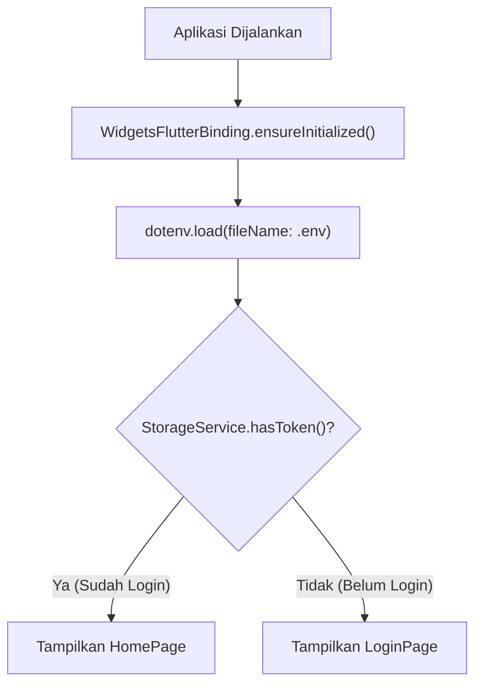

# Task 1: Implementasi Fitur Autentikasi (Login Pegawai)

Dokumentasi ini menjelaskan implementasi fitur autentikasi login mobile pada aplikasi **SiAbsen** menggunakan **GetX**, **SharedPreferences**, dan **flutter_dotenv**, sesuai dengan referensi endpoint pada [`/docs/api_docs.md`](api_docs.md).

---

## 📌 1. Ringkasan Task

- [x] Konfigurasi environment `.env` untuk Base URL backend
- [x] Implementasi struktur arsitektur folder (`models`, `services`, `controllers`, `pages`)
- [x] Integrasi endpoint `POST /api/v1/auth/login` (login menggunakan Email atau NIP)
- [x] Validasi input form dan penanganan error respons API (`422 Unprocessable Entity` / `401 Unauthorized`)
- [x] Penyimpanan token dan data profil pengguna di lokal via `SharedPreferences`
- [x] Navigasi otomatis ke `HomePage` setelah login berhasil menggunakan GetX
- [x] Pengecekan sesi aktif (auto-login) pada `main.dart` saat aplikasi pertama kali dimuat

---

## ⚙️ 2. Konfigurasi Environment (`.env`)

File [`.env`](../.env) diletakkan di root project dan didaftarkan sebagai asset di [`pubspec.yaml`](../pubspec.yaml):

```env
BASE_URL=https://demo-presensi.farham.my.id/api/v1
BASE_HOST=https://demo-presensi.farham.my.id
```

### Dependensi yang Digunakan
```yaml
dependencies:
  flutter:
    sdk: flutter
  cupertino_icons: ^1.0.8
  get: ^4.7.3                 # State management & routing
  google_fonts: ^8.2.1        # Tipografi Poppins
  shared_preferences: ^2.5.5  # Penyimpanan lokal token & user
  flutter_dotenv: ^6.0.1      # Pembaca file environment
  http: ^1.6.0                # HTTP Client request REST API
```

---

## 📂 3. Struktur Berkas yang Diimplementasikan

```text
lib/
├── controllers/
│   └── login_controller.dart     # Pengendali state form, loading, toggle password, & proses login
├── models/
│   ├── user_model.dart           # Model serialisasi data profil pegawai
│   └── login_response_model.dart # Model serialisasi response dari endpoint /auth/login
├── pages/
│   ├── login_page.dart           # Antarmuka form login dengan Google Fonts & GetX reactive
│   └── home_page.dart            # Halaman utama pasca-login (menampilkan info user & logout)
├── services/
│   ├── api_service.dart          # Layanan HTTP request ke backend & penanganan respons/error
│   └── storage_service.dart      # Abstraksi SharedPreferences (save/get/clear token & user)
└── main.dart                     # Inisialisasi dotenv, auto-login check, & root GetMaterialApp
```

---

## 🔌 4. Integrasi Endpoint API

- **Endpoint**: `POST /api/v1/auth/login`
- **Headers**:
  ```http
  Accept: application/json
  Content-Type: application/json
  ```
- **Payload Request**:
  ```json
  {
    "identifier": "<email_atau_nip>",
    "password": "<kata_sandi>",
    "device_name": "Flutter Mobile App"
  }
  ```

### Penanganan Respons:
1. **Sukses (`200 OK`)**:
   - Menyimpan `token` dan objek data `user` ke local storage.
   - Menampilkan notifikasi popup hijau (`Get.snackbar`).
   - Navigasi penuh menuju `HomePage` melalui `Get.offAll(() => const HomePage())`.
2. **Validasi Gagal (`422 Unprocessable Entity`)**:
   - Mengambil pesan error dari key `errors` pada payload response backend.
   - Menampilkan pesan kesalahan detail melalui `Get.snackbar` berwarna merah.

---

## 💾 5. Penyimpanan Lokal (`StorageService`)

Penyimpanan data lokal dikelola melalui class [`StorageService`](../lib/services/storage_service.dart):

| Kunci Penyimpanan | Tipe Data | Keterangan |
|---|---|---|
| `auth_token` | `String` | Token Sanctum Bearer untuk otorisasi request terproteksi. |
| `auth_user` | `String` (JSON) | Objek data pegawai dalam format string JSON (`UserModel`). |

### Method Utama:
- `saveToken(String token)`: Menyimpan token sesi.
- `getToken()`: Mengambil token aktif.
- `saveUser(UserModel user)`: Menyimpan data profil user.
- `getUser()`: Membaca & parsing kembali string JSON menjadi objek `UserModel`.
- `hasToken()`: Memeriksa apakah token sudah tersedia di local storage.
- `clearAll()`: Menghapus token dan data user saat melakukan logout.

---

## 🔄 6. Alur Inisialisasi Aplikasi (`main.dart`)


