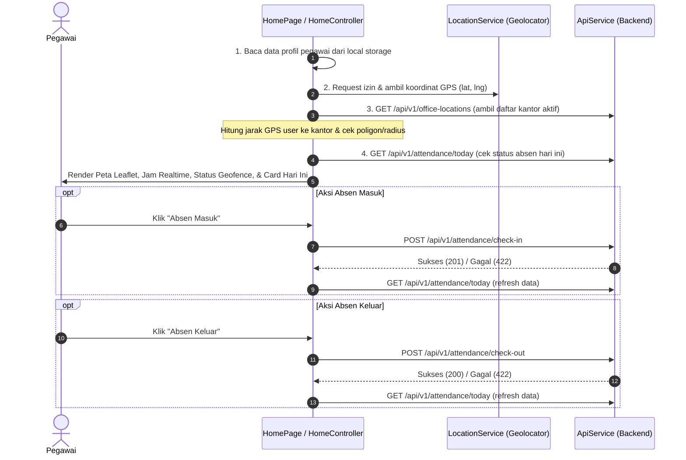

# Task 2: Implementasi Halaman Home & Dashboard Presensi

Dokumentasi ini menjelaskan implementasi halaman Home dan navigasi utama aplikasi **SiAbsen** menggunakan **GetX**, peta **Leaflet** (`flutter_map`), koordinat GPS (`geolocator`), dan integrasi REST API backend.

---

## 📌 1. Checklist Implementasi

- [x] **Bottom Navigation Bar (3 Menu)**:
  - `HOME`: Halaman presensi utama.
  - `RIWAYAT`: Halaman riwayat presensi (fondasi Task 3).
  - `PROFILE`: Halaman informasi profil & logout (fondasi Task 4).
- [x] **Header Profil**: Menampilkan nama pegawai dan bagian / unit kerja.
- [x] **Tanggal & Jam Real-Time**: Tanggal hari ini (Bahasa Indonesia) dan jam digital berdetik per detik (`Timer.periodic`).
- [x] **Peta Lokasi Leaflet (`flutter_map`)**:
  - Menggunakan tile OpenStreetMap (tanpa API key berbayar).
  - Marker titik pengguna (biru) dan marker titik kantor (merah).
  - Lingkaran radius area kantor (`CircleMarker`) dan polygon geofence (`PolygonLayer`).
  - Tombol pusatkan kembali ke lokasi pengguna (`recenter_gps`).
- [x] **Informasi Status Geofence**:
  - Deteksi posisi otomatis: **Di Dalam Area Kantor** (hijau) atau **Di Luar Area Kantor** (merah) beserta jarak dalam meter ke kantor terdekat.
- [x] **Tombol Absen Masuk & Absen Keluar**:
  - **Absen Masuk**: Aktif jika belum melakukan check-in hari ini.
  - **Absen Keluar**: Aktif jika sudah check-in dan belum check-out.
  - State indikator loading saat pengiriman request berlangsung.
- [x] **Card Presensi Hari Ini**:
  - Menampilkan status kehadiran (`Hadir`, `Terlambat`, `Di Luar Area`), jam masuk, jam pulang, dan catatan.

---

## 📦 2. Dependensi & Izin Perangkat

### Paket Tambahan
- `flutter_map: ^8.3.2` & `latlong2: ^0.10.1`: Widget peta berbasis Leaflet.
- `geolocator: ^14.1.2`: Deteksi koordinat GPS dan perhitungan jarak dua koordinat.
- `intl: ^0.20.3`: Pengolahan waktu dan format tanggal.

### Izin Perangkat (Permissions)
- **Android** (`android/app/src/main/AndroidManifest.xml`):
  - `android.permission.INTERNET`
  - `android.permission.ACCESS_FINE_LOCATION`
  - `android.permission.ACCESS_COARSE_LOCATION`
- **iOS** (`ios/Runner/Info.plist`):
  - `NSLocationWhenInUseUsageDescription`
  - `NSLocationAlwaysAndWhenInUseUsageDescription`

---

## 📂 3. Struktur Berkas yang Terlibat

```text
lib/
├── controllers/
│   ├── main_nav_controller.dart     # Manajemen index BottomNavigationBar
│   └── home_controller.dart         # Logika koordinat GPS, live clock, hitung jarak, check-in & check-out
├── models/
│   ├── office_location_model.dart   # Model titik kantor, radius, dan polygon
│   └── attendance_model.dart        # Model respons presensi hari ini
├── services/
│   ├── api_service.dart             # Integrasi endpoint /office-locations, /attendance/today, /check-in, /check-out
│   └── location_service.dart        # Helper GPS, permission check, dan ray-casting poligon
└── pages/
    ├── main_navigation_page.dart    # Scaffolding dengan BottomNavigationBar (HOME | RIWAYAT | PROFILE)
    ├── home_page.dart               # Tampilan UI Home lengkap
    ├── history_page.dart            # Halaman Riwayat (placeholder Task 3)
    └── profile_page.dart            # Halaman Profil (placeholder Task 4)
```

---

## 🔄 4. Alur Kerja Data (Flow)



---

## 🔌 5. Endpoint API yang Digunakan

1. `GET /api/v1/office-locations`: Mengambil titik koordinat kantor, radius meter, dan koordinat poligon.
2. `GET /api/v1/attendance/today`: Mengambil status presensi hari ini (`has_checked_in`, `has_checked_out`, dan data presensi).
3. `POST /api/v1/attendance/check-in`: Melakukan presensi masuk dengan mengirimkan koordinat latitude, longitude, dan ID lokasi kantor.
4. `POST /api/v1/attendance/check-out`: Melakukan presensi pulang dengan koordinat latitude dan longitude terkini.
